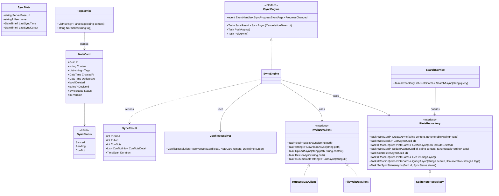
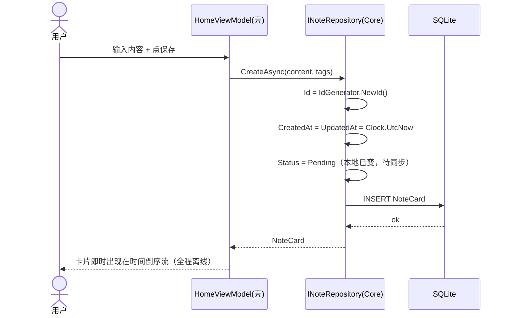
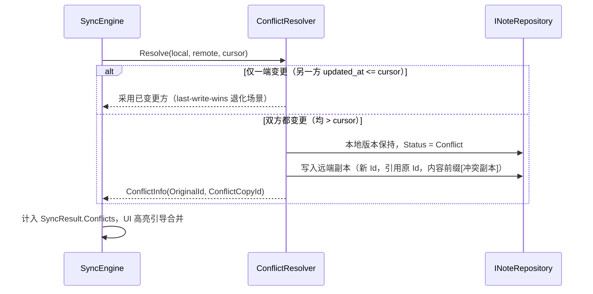
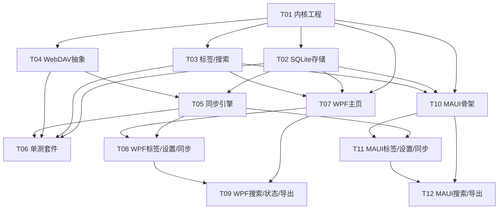

# 毛豆笔记（Maodou Notes）系统架构设计 + 任务分解

> 文档作者：架构师 高见远
> 交付对象：交付总监 齐活林（中转给工程师）
> 日期：2026-11-08
> 配套 PRD：产品经理（Alice 视角）已交付《毛豆笔记 PRD v1》

---

## 0. 文档导航

| 章节 | 内容 |
|------|------|
| 1 | 实现方案 + 框架选型论证（含 6 项待确认项的推荐默认值） |
| 2 | 目录 / 文件列表（Core / Windows / Android / Tests 四部分） |
| 3 | 核心数据结构与接口（类图 + 关键方法签名） |
| 4 | 程序调用流程（时序图：离线保存 / WebDAV 增量同步 / 冲突处理） |
| 5 | 任务列表（有序、含依赖、标记 P0/P1、含产出文件 + 验收标准） |
| 6 | 依赖包列表（NuGet） |
| 7 | 共享知识（跨文件约定） |
| 8 | 待明确事项 |
| 9 | 本机可验证范围（Core 单元测试覆盖清单） |

---

## 1. 实现方案 + 框架选型论证

### 1.1 总体架构：一套核心 + 双端原生壳

```
┌─────────────────────── Maodou.Core (net8.0 共享内核) ───────────────────────┐
│  数据模型 · SQLite 离线存储 · 标签/搜索服务 · WebDAV 同步引擎 · 冲突处理      │
└───────────────┬───────────────────────────────────────┬───────────────────┘
                │ 引用（ProjectReference）                │ 引用（ProjectReference）
        ┌───────▼────────┐                        ┌──────▼─────────┐
        │ Maodou.Desktop │                        │ Maodou.Mobile  │
        │ WPF (Windows)  │                        │ MAUI (Android) │
        │ 原生 Win32 应用 │                        │ 原生 Android 应用│
        └────────────────┘                        └────────────────┘
```

**核心思想**：所有"会出 bug 的硬逻辑"（离线 CRUD、增量同步、冲突保留）全部下沉到 `Maodou.Core` 这个纯 .NET 8 类库。两端 UI（WPF / MAUI）只是"壳"——负责渲染卡片流、调起同步、读用户输入，真正的数据与同步决策都在 Core 里完成，因此**同一套核心逻辑覆盖双端原生，且可在本机用 xUnit 直接跑测试，无需构建 Android/Windows 完整应用**。

### 1.2 待确认项 —— 推荐默认值及论证

| # | 待确认项 | 推荐默认值 | 论证 |
|---|----------|-----------|------|
| 1 | 双端技术栈 | **MAUI（Android）+ WPF（Windows）+ 共享 Core** | 见 1.3 论证。需求明确要求".NET 共享内核 + xUnit 验证"，MAUI/WPF 是唯二能复用同一 C# 内核的原生方案；Flutter/RN 无法满足。 |
| 2 | 是否需要账号体系 | **纯本地 + 自有 WebDAV，无中心账号** | WebDAV 本身由用户自建服务器提供用户名/密码鉴权，无需我们再建一套账号体系；符合"无中心账号绑定"的产品定位。 |
| 3 | 富文本 vs 纯文本 | **MVP 纯文本；P2 再上轻量 Markdown** | 极简记录场景下纯文本足够，降低 MVP 复杂度；Markdown 渲染留到 P2。存储层一律存纯文本，渲染层后加。 |
| 4 | 标签嵌套 | **MVP 扁平标签；P2 再嵌套** | 扁平标签已能满足"#标签即结构"；嵌套需额外树形 UI 与路径解析，放 P2。 |
| 5 | 搜索范围与规模 | **SQLite FTS5，覆盖 标签 + 正文** | 个人笔记量级（数千~数万条）FTS5 完全够用，零额外依赖；索引建在 content + tags 上。 |
| 6 | 同步冲突策略 | **updated_at 增量游标；冲突保留双版本，标记 conflict 待用户合并** | 详见 1.4。last-write-wins 仅作为"仅一端变更"的退化场景，真冲突绝不丢数据。 |

### 1.3 技术栈收敛论证（待确认项 1 展开）

**为什么选 .NET 8 共享内核 + MAUI + WPF？**

1. **需求硬性约束**：PRD 与总监都要求"一套核心代码覆盖双端 + 本机 xUnit 验证离线 CRUD 与 WebDAV 同步往返"。只有 .NET 生态能同时给 Android（MAUI）和 Windows（WPF/WinUI）提供**同一语言、同一套类库（Microsoft.Data.Sqlite 跨平台）**的原生方案。Flutter/Dart、React Native 都无法复用 C# 内核，直接出局。
2. **Microsoft.Data.Sqlite 跨平台**：同一套 SQLite 访问代码在 Windows 与 Android 上行为一致，且自带 FTS5（需 `SQLitePCLRaw.bundle_e_sqlite3` 提供原生引擎）。
3. **可测试性**：Core 是纯 `net8.0` 类库，不依赖任何 UI 或平台 API。用 `FileWebDavClient`（本地文件夹模拟 WebDAV）即可在本机模拟"双端同步"，xUnit 全程不需要 Android SDK 或 Windows 桌面运行时。
4. **原生体验**：MAUI 编译为真正原生 Android APK；WPF 是成熟的 Win32 原生框架，对"全局快捷键小窗（P2）"支持良好。

**WPF vs WinUI 3 的取舍**：MVP 选 **WPF**——成熟稳定、模板/绑定生态完善、无需 Windows App SDK 额外包袱；WinUI 3 可作为后续升级路径（不影响 Core）。

**风险与对策**：
- MAUI 在低端机偶有性能抖动 → 本应用 UI 极简（卡片流 + 几个 Page），性能压力小；核心逻辑在 Core，MAUI 只做薄壳。
- MAUI 需安装 `maui` workload → 在 T10/T11 的工程配置里写清 `dotnet workload install maui`。

**结论**：MAUI + WPF + 共享 Core 是当前需求下的最优解，方案成立。

### 1.4 同步冲突策略（待确认项 6 展开）

- **同步基元**：每条 `NoteCard` 以本地生成的 `Id`（UUID）作为全局同步主键；`updated_at`（UTC）是冲突判定依据；`created_at`（UTC）不可变；`deleted` 为软删除标记。
- **增量游标**：`SyncMeta.LastSyncCursor` 是一个 UTC 水位线。一次同步只处理"双方在 `cursor` 之后有变更"的卡片，避免全量对账。
- **冲突定义**：同一 `Id` 的卡片，**本地 `updated_at` 与远端 `updated_at` 都 > `LastSyncCursor`** → 真冲突。
- **退化场景（last-write-wins）**：只有一端在 `cursor` 之后变更（另一端未动）→ 直接采用已变更方，无需冲突，这等价于"最后写入者胜"，但不会发生数据互覆盖问题。
- **真冲突处理（绝不丢数据）**：
  1. 本地版本保持不动（其内容即为用户本地最新意图）；
  2. 将远端版本**另存为一份"冲突副本"**（新 Id，内容前缀 `[冲突副本]` 或写入独立 `ConflictStore`，并保留原 Id 引用）；
  3. 本地版本 `sync_status = Conflict`，UI 在卡片流中高亮，引导用户手动合并/取舍；
  4. 合并完成后清除冲突标记。
- **软删除的同步**：`deleted=true` 作为一次普通变更随增量同步传播；两端都软删后该卡片在常规视图隐藏，但物理行保留（可后续彻底清除）。

### 1.5 MVP 范围界定（P0 落地边界）

**纳入 MVP（P0）**：双端新建文本卡片、#标签、首页时间倒序卡片流、单/多标签筛选、本地优先断网可用、配置 WebDAV + 手动/自动同步、编辑 + 软删除、冲突不丢数据（保留双版本）。
**延后（P1）**：全文搜索、标签列表+计数、created/updated 保留、导出 Markdown+JSON、同步状态可视化、无干扰自动保存。
**更后（P2）**：标签嵌套、图片附件、每日随机回顾、轻量 Markdown、双向链接、Windows 全局快捷键小窗。

---

## 2. 目录 / 文件列表

```
maodou-notes/
├── Maodou.sln
├── src/
│   ├── Maodou.Core/                      # 共享内核 (net8.0)
│   │   ├── Maodou.Core.csproj
│   │   ├── Models/
│   │   │   ├── NoteCard.cs
│   │   │   ├── SyncMeta.cs
│   │   │   ├── SyncStatus.cs
│   │   │   └── SyncChangeLog.cs
│   │   ├── Storage/
│   │   │   ├── INoteRepository.cs
│   │   │   ├── SqliteNoteRepository.cs
│   │   │   ├── ISyncStateStore.cs
│   │   │   ├── SqliteSyncStateStore.cs
│   │   │   └── DbInitializer.cs
│   │   ├── Sync/
│   │   │   ├── ISyncEngine.cs
│   │   │   ├── SyncEngine.cs
│   │   │   ├── IWebDavClient.cs
│   │   │   ├── FileWebDavClient.cs        # 本地文件系统实现（测试/单机）
│   │   │   ├── HttpWebDavClient.cs        # 真实 WebDAV HTTP 实现
│   │   │   ├── ConflictResolver.cs
│   │   │   └── SyncResult.cs
│   │   ├── Services/
│   │   │   ├── TagService.cs              # 标签解析/规范化
│   │   │   └── SearchService.cs           # FTS5 封装
│   │   └── Utils/
│   │       ├── IdGenerator.cs             # UUID 生成
│   │       └── Clock.cs                   # UTC 时间源（可注入便于测试）
│   │
│   ├── Maodou.Desktop/                    # Windows WPF (net8.0-windows)
│   │   ├── Maodou.Desktop.csproj
│   │   ├── App.xaml  / App.xaml.cs
│   │   ├── MainWindow.xaml / MainWindow.xaml.cs
│   │   ├── Views/
│   │   │   ├── HomeView.xaml      / HomeView.xaml.cs
│   │   │   ├── TagsView.xaml      / TagsView.xaml.cs
│   │   │   └── SettingsView.xaml  / SettingsView.xaml.cs
│   │   ├── ViewModels/
│   │   │   ├── HomeViewModel.cs
│   │   │   ├── TagsViewModel.cs
│   │   │   └── SettingsViewModel.cs
│   │   └── Services/
│   │       └── DesktopSyncHost.cs         # 后台自动同步调度
│   │
│   └── Maodou.Mobile/                     # Android MAUI (net8.0-android)
│       ├── Maodou.Mobile.csproj
│       ├── App.xaml / App.xaml.cs
│       ├── MainPage.xaml / MainPage.xaml.cs
│       ├── Pages/
│       │   ├── HomePage.xaml      / HomePage.xaml.cs
│       │   ├── TagsPage.xaml      / TagsPage.xaml.cs
│       │   └── SettingsPage.xaml  / SettingsPage.xaml.cs
│       ├── Platforms/Android/...          # MAUI Android 平台入口
│       └── Services/
│           └── AndroidSyncHost.cs
│
├── tests/
│   └── Maodou.Tests/                      # xUnit (net8.0)
│       ├── Maodou.Tests.csproj
│       ├── SqliteNoteRepositoryTests.cs
│       ├── TagServiceTests.cs
│       ├── SearchServiceTests.cs
│       ├── SyncEngineTests.cs             # 用 FileWebDavClient 模拟双端
│       └── ConflictResolverTests.cs
│
└── architecture/
    └── ARCHITECTURE.md
```

---

## 3. 核心数据结构与接口

### 3.1 类图（Mermaid）



### 3.2 关键类型定义（摘选）

```csharp
// Models/SyncStatus.cs
public enum SyncStatus { Synced, Pending, Conflict }

// Models/NoteCard.cs
public class NoteCard
{
    public Guid Id { get; set; }              // 本地生成，全局同步主键，永不变更
    public string Content { get; set; } = ""; // 纯文本（P2 之前）
    public List<string> Tags { get; set; } = new(); // 去 # 存储，规范化后
    public DateTime CreatedAt { get; set; }   // UTC，不可变
    public DateTime UpdatedAt { get; set; }   // UTC，冲突判定依据
    public bool Deleted { get; set; }         // 软删除
    public string? DeviceId { get; set; }     // 可选，来源设备
    public SyncStatus Status { get; set; }    // 同步状态
    public int Version { get; set; }          // 乐观并发（可选）
}

// Models/SyncMeta.cs
public class SyncMeta
{
    public string ServerBaseUrl { get; set; } = "";
    public string? Username { get; set; }
    public DateTime? LastSyncTime { get; set; }   // UTC
    public DateTime? LastSyncCursor { get; set; } // UTC 增量水位线
}

// Sync/SyncResult.cs
public class SyncResult
{
    public int Pushed { get; set; }
    public int Pulled { get; set; }
    public int Conflicts { get; set; }
    public List<ConflictInfo> ConflictsDetail { get; set; } = new();
    public TimeSpan Duration { get; set; }
}
public class ConflictInfo
{
    public Guid OriginalId { get; set; }
    public Guid ConflictCopyId { get; set; } // 另存的远端副本 Id
}
```

### 3.3 仓储与同步接口（关键方法签名）

```csharp
// Storage/INoteRepository.cs
public interface INoteRepository
{
    Task<NoteCard> CreateAsync(string content, IEnumerable<string> tags);
    Task<NoteCard?> GetAsync(Guid id);
    Task<IReadOnlyList<NoteCard>> GetAllAsync(bool includeDeleted = false);
    Task<NoteCard> UpdateAsync(Guid id, string content, IEnumerable<string> tags);
    Task SoftDeleteAsync(Guid id);
    Task<IReadOnlyList<NoteCard>> GetPendingAsync();   // Status == Pending
    Task<IReadOnlyList<NoteCard>> QueryAsync(string? search, IEnumerable<string>? tags);
    Task SetSyncStatusAsync(Guid id, SyncStatus status);
}

// Sync/ISyncEngine.cs
public interface ISyncEngine
{
    Task<SyncResult> SyncAsync(CancellationToken ct = default);
    Task PushAsync();
    Task PullAsync();
    event EventHandler<SyncProgressEventArgs>? ProgressChanged;
}

// Sync/IWebDavClient.cs  —— 抽象掉"远端"差异，便于用本地文件夹做测试替身
public interface IWebDavClient
{
    Task<bool> ExistsAsync(string path);
    Task<string?> DownloadAsync(string path);          // 不存在返回 null
    Task UploadAsync(string path, string content);     // PUT（覆盖写）
    Task DeleteAsync(string path);
    Task<IEnumerable<string>> ListAsync(string dir);
}
```

> **设计要点**：`IWebDavClient` 是关键抽象。真实远端用 `HttpWebDavClient`（WebDAV 协议 PUT/GET/PROPFIND/DELETE），测试与单机模式用 `FileWebDavClient`（本地目录读写）。同步引擎只依赖接口，因此**无需真实 WebDAV 服务器即可在本机验证双端同步**。

---

## 4. 程序调用流程（时序图）

### 4.1 新建卡片（离线保存，G1 ≤3 秒）



### 4.2 WebDAV 增量同步（上传 + 下载）

```mermaid
sequenceDiagram
    participant U as 用户/定时
    participant SE as SyncEngine(Core)
    participant R as INoteRepository
    participant WD as IWebDavClient
    participant M as SyncMeta

    U->>SE: SyncAsync()
    SE->>WD: DownloadAsync("/maodou/notes.json")
    WD-->>SE: remoteNotes[] (或 null)
    SE->>R: GetPendingAsync() + GetAllAsync()
    SE->>SE: 计算增量（updated_at > cursor）
    loop 每条 remote 变更
        SE->>SE: 冲突检测（local & remote 均 > cursor?）
        alt 真冲突
            SE->>R: 本地保留 + 存远端副本 + Status=Conflict
        else 仅远端变化
            SE->>R: 应用远端版本
        end
    end
    SE->>R: 将本地 Pending 合入待上传集合
    SE->>WD: UploadAsync("/maodou/notes.json", mergedSnapshot)
    SE->>M: LastSyncCursor = Clock.UtcNow; LastSyncTime = ...
    SE-->>U: SyncResult(Pushed, Pulled, Conflicts)
```

> 远端数据形态（MVP 简化）：单个 `notes.json` 存放全部卡片快照（个人量级足够，避免大量 WebDAV 往返）；`SyncMeta` 的 `LastSyncCursor` 作为水位线。后续可优化为按 `Id` 分文件 + 变更日志，但 Core 接口不受影响。

### 4.3 冲突处理流程（绝不丢数据）



---

## 5. 任务列表（有序 · 含依赖 · 标记 P0/P1）

> 顺序即实现顺序；"产出文件"给出该任务主要新建/修改文件；"验收标准"为完成定义。

| 任务 | 名称 | 优先级 | 依赖 | 产出文件（主要） | 验收标准 |
|------|------|--------|------|----------------|----------|
| **T01** | 项目骨架 + 共享内核工程与模型/接口 | P0 | — | `Maodou.sln`, `Maodou.Core.csproj`, `Models/*.cs`, `Storage/INoteRepository.cs`, `Sync/ISyncEngine.cs`, `Sync/IWebDavClient.cs` | 解决方案可编译；所有接口与模型定义完整；无缺失引用。 |
| **T02** | SQLite 离线存储层 | P0 | T01 | `Storage/SqliteNoteRepository.cs`, `Storage/SqliteSyncStateStore.cs`, `Storage/DbInitializer.cs`, `Models/SyncMeta.cs` | 单元测试通过：Create/Get/Update/SoftDelete/GetPending/GetAll；DB 表结构与索引（含 FTS5）正确。 |
| **T03** | 标签解析 + 全文搜索服务 | P1 | T01 | `Services/TagService.cs`, `Services/SearchService.cs` | 标签去#/规范化/去重单测通过；FTS5 对 content+tags 的查询单测通过。 |
| **T04** | WebDAV 抽象 + 文件系统实现 | P0 | T01 | `Sync/IWebDavClient.cs(实现)`, `Sync/FileWebDavClient.cs` | Exists/Download/Upload/Delete/List 单测通过（本地临时目录）。 |
| **T05** | 同步引擎 + 冲突处理 + 真实 WebDAV 客户端 | P0 | T02, T04 | `Sync/SyncEngine.cs`, `Sync/ConflictResolver.cs`, `Sync/HttpWebDavClient.cs`, `Sync/SyncResult.cs` | 双端增量同步往返单测通过；真冲突保留双版本并标记 Conflict 单测通过。 |
| **T06** | Core 单元测试套件（离线 CRUD + 同步往返 + 冲突） | P0 | T02, T03, T04, T05 | `tests/Maodou.Tests/*` | `dotnet test` 全绿；覆盖第 9 章清单。 |
| **T07** | WPF 应用骨架 + 首页卡片流 | P0 | T01, T02, T03 | `Maodou.Desktop.csproj`, `App.xaml*`, `MainWindow.xaml*`, `Views/HomeView.xaml*`, `ViewModels/HomeViewModel.cs` | 可新建/查看/软删卡片，时间倒序流正确，断网可用。 |
| **T08** | WPF 标签筛选 + 设置(WebDAV) + 手动/自动同步 | P0 | T05, T07 | `Views/TagsView.xaml*`, `Views/SettingsView.xaml*`, `ViewModels/*ViewModel.cs`, `Services/DesktopSyncHost.cs` | 配置 WebDAV 后手动同步成功；单/多标签筛选正确；可触发自动同步。 |
| **T09** | WPF 搜索 + 同步状态可视化 + 导出 | P1 | T07, T08 | `Views/HomeView.xaml*(搜索框)`, `Services/DesktopSyncHost.cs(状态)`, 导出模块 | 全文搜索可用；同步状态（待同步/冲突数）可视化；导出 Markdown+JSON 文件正确。 |
| **T10** | MAUI 应用骨架 + 移动端三 Tab + 悬浮新建 | P0 | T01, T02, T03 | `Maodou.Mobile.csproj`, `App.xaml*`, `MainPage.xaml*`, `Pages/HomePage.xaml*`, `ViewModels/*` | Android 模拟器可新建/查看/软删卡片，离线可用，底部三 Tab + 悬浮按钮。 |
| **T11** | MAUI 标签筛选 + 设置 + 同步 | P0 | T05, T10 | `Pages/TagsPage.xaml*`, `Pages/SettingsPage.xaml*`, `Services/AndroidSyncHost.cs` | 配置 WebDAV 并同步成功；标签筛选正确。 |
| **T12** | MAUI 搜索 + 导出 | P1 | T10, T11 | `Pages/HomePage.xaml*(搜索)`, 导出模块 | 搜索可用；导出文件正确。 |

**依赖关系图（Mermaid）**



---

## 6. 依赖包列表（NuGet）

| 包 | 版本 | 用途 | 使用方 |
|----|------|------|--------|
| `Microsoft.Data.Sqlite` | ^8.0 | 跨平台 SQLite 访问（离线存储） | Core / Desktop / Mobile |
| `SQLitePCLRaw.bundle_e_sqlite3` | ^2.1 | 提供原生 SQLite 引擎（含 FTS5 支持） | Core（传递） |
| `xunit` | ^2.9 | 单元测试框架 | Tests |
| `xunit.runner.visualstudio` | ^2.8 | xUnit 测试运行器 | Tests |
| `Microsoft.NET.Test.Sdk` | ^17.11 | 测试 SDK | Tests |
| `Moq`（或 `NSubstitute`） | ^4.20 | 测试中 Mock 接口 | Tests |
| `WebDav.Client` | ^2.9 | 真实 WebDAV HTTP 客户端（PUT/GET/PROPFIND/DELETE） | Core（HttpWebDavClient） |
| `CommunityToolkit.Mvvm` | ^8.2 | MVVM Source Generator（VM 绑定，两端共用） | Desktop / Mobile |
| `Microsoft.Extensions.DependencyInjection` | ^8.0 | 依赖注入（组装 Core 与壳） | Core / Desktop / Mobile |
| `Serilog`（可选） | ^4.0 | 结构化日志（同步过程排错） | Core / Desktop / Mobile |

> **关于 WebDAV 客户端库**：`WebDav.Client`（GitHub: wintereat/WebDav.Client）对基础动词支持良好，适合 MVP；若目标服务器需要 Lock/Propfind 深度控制，可替换为 `Flurl.Http` 手写 WebDAV 请求，因已抽象 `IWebDavClient`，替换不影响 Core 其余部分。

---

## 7. 共享知识（跨文件约定）

1. **UUID 生成规则**：`Id = IdGenerator.NewId()`（MVP 用 `Guid.NewGuid()`；P2 可换 UUIDv7 以获得时间有序）。`Id` 是**全局同步主键**，一旦生成永不重新生成、永不回收。
2. **时间统一 UTC**：所有时间戳（`CreatedAt`/`UpdatedAt`/`LastSyncTime`/`LastSyncCursor`）均为 **UTC**。`CreatedAt` 不可变；`UpdatedAt` 在每次本地编辑/软删时刷新，是冲突判定依据。`Clock.UtcNow` 经可注入的 `IClock` 提供，便于测试。
3. **标签去 `#` 存储**：用户输入的 `#标签` 在 `TagService` 解析后，**存储时不带 `#`**；展示层统一加 `#` 前缀。规范化：去除首尾空白、折叠内部连续空白、按原大小写保留（P2 嵌套前不强制小写，避免误合并）。同卡片内标签去重。
4. **软删除约定**：`Deleted=true` 表示软删除，常规查询默认排除；物理行**不立即删除**，随同步传播；仅在用户主动"彻底清除"或冲突副本清理时硬删。
5. **同步游标语义**：`LastSyncCursor` 是 UTC 水位线。一次同步只处理 `updated_at > cursor` 的本地 Pending 与远端变更；真冲突 = 本地与远端同一 `Id` 的 `updated_at` 都 > `cursor`。同步成功后 `cursor = 本次处理到的最大 updated_at`（或 `Clock.UtcNow`）。
6. **同步状态机**：新建/编辑/软删 → `Pending`；成功上传且未被远端覆盖 → `Synced`；检测到真冲突 → `Conflict`（保留双版本，待用户合并）。
7. **远端数据形态（MVP）**：单个 `notes.json` 存放全量卡片快照（UTF-8 JSON 数组），`SyncMeta` 仅本地存储于设备数据库，不传远端。后续可演进为按 `Id` 分文件 + 变更日志，Core 接口不变。
8. **编码与序列化**：卡片以 UTF-8 JSON 序列化；WebDAV `UploadAsync` 写入 UTF-8 文本。

---

## 8. 待明确事项

1. **时钟漂移**：增量/冲突依赖 `updated_at` 比较，假设双端设备时钟大致同步。若需严格正确，应引入"服务端单调序号"替代纯时间戳；当前 MVP 以 2 端、时钟近似同步为前提（见 1.4）。
2. **WebDAV 服务器兼容性**：部分服务器不支持 `PROPFIND` 深度列举或对覆盖写有权限限制，需在 `HttpWebDavClient` 做兼容性适配与错误提示。
3. **MAUI Android 最低 API 级别**：建议 `net8.0-android` + `MinAndroidVersion = Android 8.0 (API 26)`，待工程师确认。
4. **WebDAV 凭据安全**：`Username`/`Password` 建议在设备端加密存储（如 Windows DPAPI / Android EncryptedSharedPreferences），不在 `SyncMeta` 明文落库；本设计预留 `ISecureStorage` 抽象。
5. **大数据量阈值**：FTS5 + 单文件 `notes.json` 在数万条内无碍；若超十万条需切分远端文件，列为 P2 优化。
6. **多于 2 端的冲突语义**：当前游标模型在 2 端最稳；3 端以上需更严谨的向量时钟/服务端序号，列为后续演进。

---

## 9. 本机可验证范围（Core 单元测试覆盖清单）

> 关键价值：以下全部在 `net8.0` + `FileWebDavClient`（本地临时目录模拟 WebDAV）下完成，**无需 Android SDK 或 Windows 桌面运行时**，由 `dotnet test` 直接验证。

| 验证项 | 对应测试类 | 覆盖要点 |
|--------|-----------|----------|
| **离线 CRUD** | `SqliteNoteRepositoryTests` | 新建（生成 Id、UTC 时间、Pending）、按 Id 查询、更新（刷新 UpdatedAt）、软删除（Deleted=true 且默认排除）、GetAll/Pending 列表正确。 |
| **标签解析与规范化** | `TagServiceTests` | 从 `#标签` 提取、去 `#` 存储、空白折叠、去重、空内容处理。 |
| **全文搜索（FTS5）** | `SearchServiceTests` | 关键词命中 content 与 tags；中文分词/子串匹配；排除软删除。 |
| **增量同步往返** | `SyncEngineTests` | 用两个 Core 实例 + 同一本地"远端"目录模拟双端：A 新建→同步→B 拉取得到；B 编辑→同步→A 拉取更新；`LastSyncCursor` 正确推进且持久化。 |
| **冲突保留双版本** | `ConflictResolverTests` + `SyncEngineTests` | 两端在 cursor 后各改同一 Id：本地保留、远端存为冲突副本、原卡 `Status=Conflict`、两份内容都不丢；`SyncResult.Conflicts` 正确计数。 |
| **退化场景（last-write-wins）** | `SyncEngineTests` | 仅一端变更时直接采用，不产生冲突。 |
| **软删除同步** | `SyncEngineTests` | A 软删→同步→B 拉取后该卡在 B 也软删（默认视图隐藏）。 |
| **同步状态持久化** | `SqliteSyncStateStore` 测试 | `SyncMeta`（cursor/时间）在库重建后仍能正确读取，保证重启不重复全量对账。 |

**本机无法验证（需真机/真环境）**：MAUI Android UI 交互与权限、WPF 窗口与全局快捷键、真实 WebDAV 服务器协议兼容性、跨网络同步性能。这些由 T07–T12 在对应平台上人工/端到端验证。

---

> 结语：本设计以"Core 下沉、双端薄壳"为纲，确保最难验证的离线 CRUD 与增量同步在本机即可用 xUnit 跑通；6 项待确认项已给出推荐默认值与论证，MVP 边界清晰（P0 落地、P1/P2 延后）。任务列表按依赖排序，可直接转交工程师排期。
